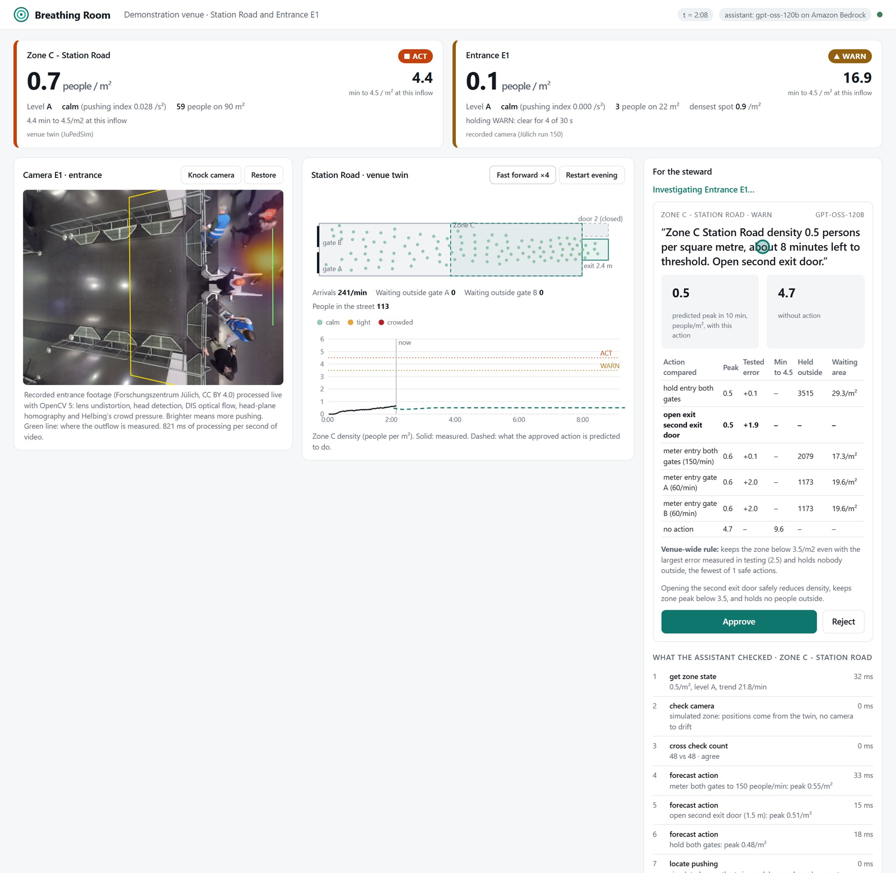

# Breathing Room

Breathing Room turns the CCTV a venue already has into three numbers per zone: how full it is
(people per m²), whether the crowd has started to push (a motion-based pushing index), and how
many minutes remain before the zone reaches a dangerous density at the current inflow. When a
zone needs attention, an agent checks the camera, counts the crowd a second way, compares the
actions the venue can take, and puts one proposal with its predicted effect in front of a
steward. The steward approves or rejects it, and 90 seconds later the system measures whether
the action worked.

**Live console:** <https://44-199-44-59.sslip.io> (no login; it pauses when nobody is watching and
starts a fresh evening for the next visitor) · **Film:** _link added after upload_ ·
**Technical report:** [docs/REPORT.md](docs/REPORT.md)

Built for the OpenCV AI Competition 2026 by Marc Donovici, on OpenCV 5.0 and AWS.



## Why a head count is not enough

At Itaewon, Seoul, on 29 October 2022, the first emergency call warning of a crush came at
18:34, and the crush that killed 159 people happened at about 22:15. Since then, Seoul has put
crowd-counting software on hundreds of CCTV cameras. A count says how full a street is. It
cannot tell a packed but calm crowd from one where people have started to push, and it cannot
say how much time is left.

Breathing Room adds both, and measures them on real data:

| Claim | Result | Evidence |
|---|---|---|
| The pushing index, read from video alone, picks out the people that trained raters saw pushing | AUROC **0.798** [0.767, 0.828] over 9,260 rated person-seconds (342 people, 6 Jülich entrance runs); no training | [eval/test_a_pushing.py](eval/test_a_pushing.py), [results](eval/results/test_a_scores.json) |
| It still works at equal density, where a head count carries no signal | AUROC **0.86, 0.84, 0.74, 0.73, 0.69** within the 0–2, 2–3, 3–4, 4–5 and 5+ people/m² bands | same |
| One alert threshold transfers between runs | 0.11 /s², set on runs 030/040/050, flags **90%** of pushing and 31% of walking person-seconds on runs 060/150/160 | [results](eval/results/test_a_threshold.json) |
| Density from video matches the reference trajectories | Pearson **0.996**, mean error 0.13 people/m² | [results](eval/results/test_a_scores.json) |
| Outflow is measured from video | **56 of 56** people counted across the entrance gate line, error 0.04 people/s | [eval/test_e1_flux.py](eval/test_e1_flux.py) |
| Minutes to danger arrive early and are accurate | warning **3.6 to 4.1 minutes** before the zone reaches 4/m² (5 runs); median error **32 s** when 1 to 5 minutes ahead | [eval/test_b_twin.py](eval/test_b_twin.py) |
| The proposal picks an action that works | with each action's measured forecast error priced in, mean regret **0.01 people/m²** (out of sample), against 1.85 without | [eval/score_test_b.py](eval/score_test_b.py) |
| A knocked camera is caught before its numbers are used | **36 of 36** knocks above 0.25 m flagged, **0** false alarms in 60 checks, floor shift measured to 2 mm (median) | [eval/test_e_drift.py](eval/test_e_drift.py) |
| Counting holds on real oblique street CCTV | DM-Count QNRF on the OpenCV 5 DNN engine: **10.9%** mean error, r = 0.985 on 100 CroHD frames with 45 to 250 people | [eval/test_d_counting.py](eval/test_d_counting.py) |
| The agent makes the right kind of decision | **AGENT_RESULT** | [eval/test_c_agent.py](eval/test_c_agent.py) |
| Exit capacity comes from real bottleneck data | flow = **2.02 × width** (R² 0.81) over 24 Jülich runs; the system plans with 1.3 people/m/s, below all 24 | [eval/test_b_capacity.py](eval/test_b_capacity.py) |

## How it works


*One Graviton instance runs the OpenCV 5 pipeline, the zone physics, the tier policy and the
console. The agent calls gpt-oss-120b on Amazon Bedrock; every tier change, tool call, decision
and verification goes to a hash-chained trace mirrored to CloudWatch Logs.*

**Perception (OpenCV 5).** Each second of video gives five field samples. A frame is
undistorted with `remap`, heads are found (`cvtColor`, `inRange`, morphology,
`connectedComponentsWithStats`), DIS optical flow gives their motion, and the head-plane
homography turns pixels into metres and pixels per frame into metres per second. Helbing's
crowd fields (density, velocity variance, pressure = density × variance) are three `bincount`s
and three `GaussianBlur`s on a 0.1 m floor grid. People leaving are counted across a gate line by
matching heads between samples.

**Trust.** A watchdog matches the live frame to the calibration frame every 15 s with the OpenCV 5
features module (ALIKED keypoints, LightGlue matching, USAC MAGSAC homography) and converts the
motion of the calibration points into metres on the floor. A second, independent count comes from
DM-Count on the OpenCV 5 DNN engine.

**Minutes to danger.** The continuity equation over a zone, dN/dt = Q_in − Q_out, with N and
Q_out measured, gives the inflow and its trend without a camera on the entrances. Integrated
forward against the exits' capacity, it gives the minutes until 4.5 people/m² and the predicted
effect of each action.

**Decision.** A deterministic policy sets the tier from measured numbers only. At WARN, or when
the watchdog loses trust in a camera, an agent episode starts.


*The model chooses which tools to call and which action to propose, and writes the radio message.
Code checks every proposal: the action must be in the venue's catalogue, the proposal must cite a
forecast from its own episode, and every number in the radio message must come from a tool result.
A refusal goes back to the model as a tool result. If the model is unreachable, a deterministic
planner calls the same tools.*

## Run it

Python 3.10 or 3.11.

```bash
python -m venv .venv
.venv/Scripts/pip install -r requirements-dev.txt          # Linux/macOS: .venv/bin/pip
.venv/Scripts/pip install -e . --no-deps
python scripts/fetch_models.py                             # ALIKED, LightGlue, DM-Count (SHA-256 checked)
python scripts/fetch_data.py --videos demo                 # Jülich data to ../data (CC BY 4.0)
BR_USE_MODEL=0 .venv/Scripts/python -m uvicorn breathingroom.api:app --app-dir src --port 8000
```

Open <http://127.0.0.1:8000>. `BR_USE_MODEL=0` uses the deterministic planner; with
`BR_USE_MODEL=1` and AWS credentials that can call the Bedrock API endpoint, the agent runs on
`openai.gpt-oss-120b`. DM-Count ONNX files come from `python scripts/fetch_models.py --export`
(needs PyTorch).

| Variable | Default | Meaning |
|---|---|---|
| `BR_DATA` | `../data` | Jülich data folder |
| `BR_USE_MODEL` | `1` | `1` agent on Amazon Bedrock, `0` deterministic planner |
| `BR_MODEL_ID` | `openai.gpt-oss-120b` | model on the Bedrock API endpoint |
| `BR_TRACE` | `var/trace.jsonl` | hash-chained trace |
| `BR_CLOUDWATCH_GROUP` | unset | also send each trace entry to this log group |
| `BR_IDLE_PAUSE_S` | `0` | pause when no console has polled for this long |
| `BR_STEWARD_PIN` | unset | require a PIN to approve or reject |

## Test it

```bash
.venv/Scripts/python -m pytest -q                         # 13 unit tests
python tools/ui_smoke.py http://127.0.0.1:8000            # drives the console headless: knock, recalibration, proposal, approve, verify
```

The evaluations write to `eval/results/`:

```bash
python eval/test_a_pushing.py && python eval/score_test_a.py   # pushing index vs ratings (6 runs)
python eval/test_b_capacity.py                                 # exit capacity, 24 bottleneck runs
python eval/test_b_twin.py && python eval/score_test_b.py      # forecasts and actions on the venue twin
python eval/test_c_agent.py --repeats 5                        # agent episodes on fixed scenarios
python eval/test_d_counting.py                                 # DM-Count on CroHD (download HT21.zip to ../data/ht21)
python eval/test_e_drift.py                                    # camera watchdog against knocks of known size
python eval/test_e1_flux.py                                    # gate-line outflow against trajectories
python eval/figures.py                                         # figures in docs/figures
```

## Deploy on AWS

```bash
AWS_PROFILE=<admin> bash deploy/provision.sh                    # bucket, log group, role, security group, instance, Elastic IP
AWS_PROFILE=<admin> bash deploy/redeploy.sh <instance-id> <a-b-c-d>.sslip.io
```

`provision.sh` creates an IAM role limited to Systems Manager, the Bedrock API endpoint,
one log group and one bucket; a security group open on 80 and 443 only (no SSH: the instance is
administered through SSM); and a t4g.small (Graviton) on Amazon Linux 2023 with IMDSv2 required
and an encrypted volume. `setup_instance.sh` installs the pinned dependencies with the headless
OpenCV 5.0.0 aarch64 wheel, builds JuPedSim from source (PyPI has no aarch64 Linux wheel), and
runs the console under systemd behind Caddy, which obtains a Let's Encrypt certificate for the
sslip.io hostname.

## Repository

| Path | What it holds |
|---|---|
| `src/breathingroom/calib.py` | floor homography (USAC MAGSAC), focal length and pose from the floor, head-plane homography |
| `src/breathingroom/fields.py` | Helbing density, velocity, variance and pressure fields on a metric grid |
| `src/breathingroom/flow.py`, `density.py`, `drift.py` | DIS optical flow; DM-Count on the DNN engine; ALIKED + LightGlue watchdog |
| `src/breathingroom/physics.py` | zone mass balance, forecast, actions |
| `src/breathingroom/policy.py`, `agent.py` | deterministic tiers; agent episode, tools, guards, fallback planner |
| `src/breathingroom/runtime.py`, `twin.py`, `api.py`, `web/` | live zones, venue twin (JuPedSim), API and console |
| `src/breathingroom/trace.py` | hash-chained JSONL trace, CloudWatch Logs |
| `eval/`, `bench/`, `tests/`, `tools/` | evaluations, per-stage timing, unit tests, UI driver |
| `deploy/` | AWS provisioning, instance setup, systemd and Caddy units |

## Data and models

- Forschungszentrum Jülich pedestrian data, CC BY 4.0: 2018 entrance experiments (DOI
  10.34735/ped.2018.1), pushing ratings (DOI 10.34735/ped.2022.4), 2021 bottleneck experiments
  (DOI 10.34735/ped.2021.9). The console replays run 150 of the entrance experiments.
- The lens model and per-run homographies were recovered from the videos themselves
  (`eval/fzj_calibrate.py`): lens from SIFT matches against Alia et al.'s undistorted video,
  homography from their published pixel tracks, refined per run by matching caps to trajectories.
  Runs 030, 040, 050, 060, 150 and 160 calibrate at 2.3 to 5.6 px median error.
- CroHD / HT21 (CC BY-NC-SA 3.0) for test D only; not redistributed.
- DM-Count (MIT), ALIKED and LightGlue ONNX as pinned by opencv_extra.

## Limitations

- The E1 head detector finds the orange caps every participant wore in the Jülich experiments. On
  ordinary CCTV, heads come from a counting network: DM-Count QNRF measured 10.9% error on oblique
  street footage, while on the overhead Jülich view DM-Count undercounts (the pushing index from
  DM-Count density reaches AUROC 0.767, against 0.798 from heads).
- The venue twin's pedestrian model cannot pack people above about 4.5/m²: queues spill upstream,
  so forecast peaks above that are not scored. Forecasts of partial actions (one gate, one extra
  door) were optimistic by about 2 people/m² in the twin. The proposal ranks actions on predicted
  peak plus that measured error, and the verification step catches an action that does not bend
  the curve.
- The pushing threshold was set and tested on six runs of one experiment series.
- The camera zone replays a recording: approving an action there records the decision only.

## Responsible use

Only aggregate fields leave the camera process: no faces, no identities, no tracking across
cameras, no stored video. The same measurements could be used to disperse a lawful gathering, so
the system is meant to be operated by venue safety staff under a written purpose. Nothing
reaches a gate, a door or a public-address system without a person's approval, and every
recommendation, decision and outcome stays in a tamper-evident trace.

## Licence

Apache-2.0.
