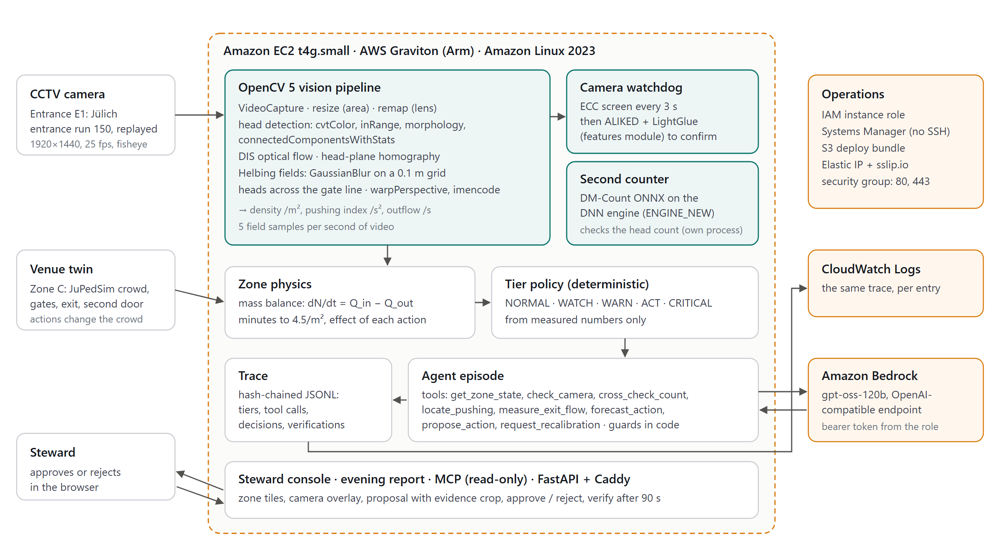
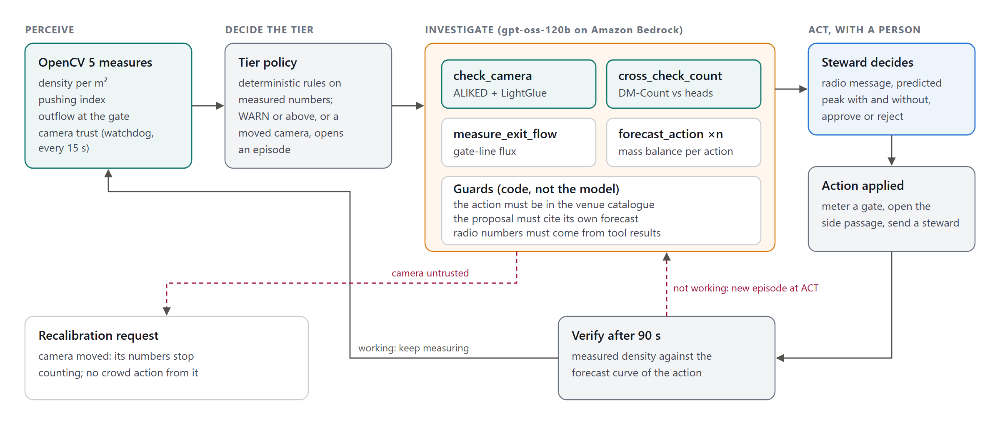
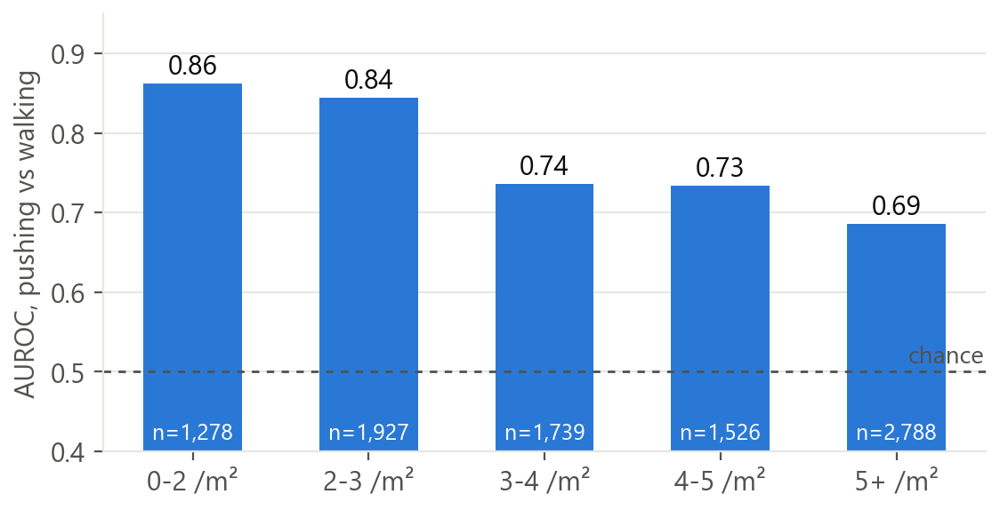
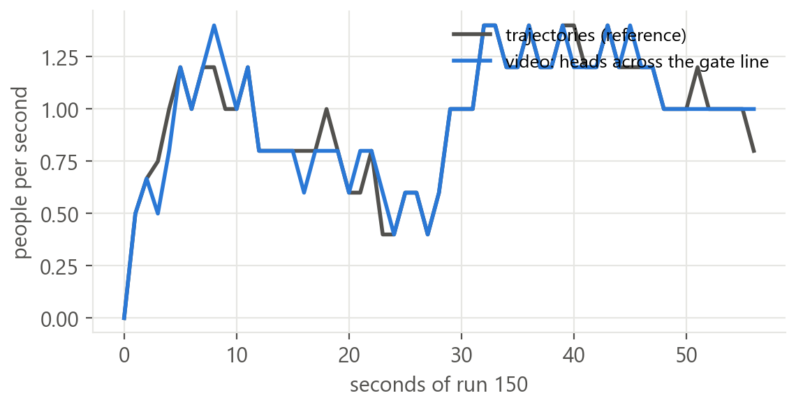
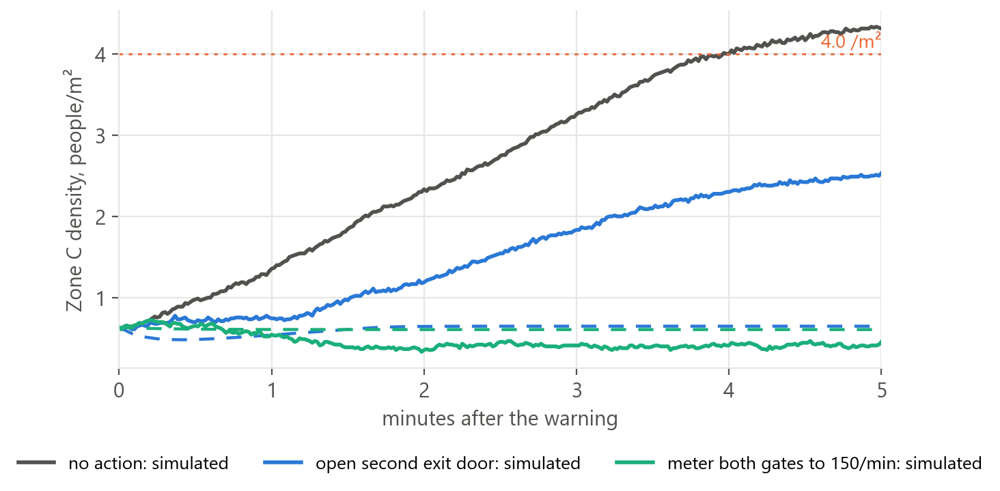

# Breathing Room: technical report

Marc Donovici · OpenCV AI Competition 2026 · October 2026

Breathing Room measures three things per zone from ordinary CCTV: density in people per m², a
pushing index from crowd motion, and minutes until the zone reaches 4.5 people per m² at the
current inflow. An agent turns a warning into one proposed action with its predicted effect and
a camera crop of where the pushing is, a steward approves or rejects it, and the system checks
90 seconds later whether the action worked. The record of the evening is hash-chained and
rendered as a report for the safety officer. This report covers the problem, the users, the architecture, the OpenCV 5
implementation, the AWS deployment, the evaluation with its failures, the limitations and
responsible use.

## 1. Problem

Crowd crushes build up over minutes, and they are visible on camera before anyone dies. At
Itaewon, Seoul, on 29 October 2022, the first of 11 emergency calls warning of a crush came at
18:34. Police investigators later estimated from security footage about 8 people per m² in the
alley at 22:15 and 9 to 11 per m² by 22:25; 159 people died. Since 2023 Seoul has run software
that counts people on CCTV and alerts the district safety room.

A head count answers one question: how full is this street? Stewards need two more answers:

1. **Has the crowd started to push?** Pushing turns a dense crowd into a dangerous one. Two
   crowds at 4 people per m² can be in very different states.
2. **How long until it becomes dangerous, and what would change that?** A density reading with
   no time and no options leaves the steward guessing.

Prior work at Forschungszentrum Jülich detects pushing at event entrances from video with a
trained classifier (Alia et al., IEEE Access 2023, 87% accuracy on their test set). Breathing
Room takes a different route: a physical index that needs no training, measured in metric units,
combined with a forecast and a closed loop with a person in charge.

## 2. Users

- **Stewards and crowd managers at events, stations and venues.** They need a short message they
  can read over the radio, a single action to approve, and confirmation that it worked.
- **Safety officers who review an evening afterwards.** They need a record of what the system
  measured, what it proposed, who decided, and what happened, that nobody can quietly edit.

## 3. Architecture

*The OpenCV 5 pipeline, zone physics, tier policy, agent loop and console run on one Graviton
instance; the agent's model is gpt-oss-120b on Amazon Bedrock; the trace is mirrored to
CloudWatch Logs.*

Two zones run side by side in the console:

- **Entrance E1** replays a real overhead recording (Jülich entrance experiment, run 150) through
  the full vision pipeline. Actions there are recorded but cannot change the footage.
- **Zone C, Station Road** is a venue twin simulated with JuPedSim: a 30 × 6 m street fed by two
  gates and ending in a 2.4 m exit, with a second 1.5 m exit door that can be opened. Approved
  actions change the simulated crowd, so the verification step has something to measure.

Each zone runs on its own thread. Heavy work happens outside the runtime lock and the state is
committed under it, so the console always reads a consistent snapshot.

## 4. OpenCV 5 implementation

| Step | OpenCV 5 | Notes |
|---|---|---|
| Decode | `VideoCapture` | read forwards with `grab`/`read`: seeking per frame cost 75 ms and could abort the FFmpeg decoder |
| Working size | `resize` (`INTER_AREA`) | each frame is reduced to half size once; the camera matrices are scaled to match, so undistortion and head search run on a quarter of the pixels |
| Lens | `initUndistortRectifyMap`, `remap`, `undistortPoints`, `projectPoints` | lens recovered from SIFT matches between the original and a published undistorted video (0.29 px median) |
| Heads | `cvtColor` (HSV), `inRange`, `connectedComponentsWithStats` | the Jülich participants wore orange caps; heads are returned in full-size undistorted pixels |
| Motion | `DISOpticalFlow` (medium, 960 px) | flow between frames 0.08 s apart |
| Metric geometry | `findHomography` (USAC MAGSAC, RANSAC fallback), `perspectiveTransform` | head-plane homography; focal length and camera pose recovered from the floor homography for oblique views |
| Crowd fields | `GaussianBlur` on a 0.1 m grid | Helbing et al. (2007): density, velocity variance, pressure = density × variance |
| Outflow | Hungarian matching of heads between samples (SciPy), line test in metres | heads crossing a line 0.4 m before the gate |
| Second count | `dnn.readNetFromONNX` with `ENGINE_NEW`, `blobFromImage` | DM-Count (SHA for the overhead view, QNRF for oblique street CCTV) |
| Camera screen | `findTransformECC` (`MOTION_HOMOGRAPHY`, coarse to fine, with a mask) | every 3 s; the mask keeps the pixels that stay still in the recording (barriers, floor, walls) |
| Camera confirmation | `ALIKED_create`, `LightGlueMatcher_create` (features module), `findHomography` (USAC MAGSAC) | when the screen sees motion, and every 10 minutes; both stages move the calibration points and measure their shift on the floor in metres |
| Where the pushing is | `connectedComponentsWithStats` on the thresholded field, `warpPerspective`, `imencode` | regions placed relative to the gate in metres, and cut out of the camera image for the steward |
| Overlay | `warpPerspective`, `applyColorMap`, `polylines`, `imencode` | the pushing field is drawn back onto the image through the homography |

**Pushing index.** For each person, Helbing's density ρ and the velocity variance within a
Gaussian kernel of R = 0.7 m are averaged over a 2 s window; the pressure is ρ × Var(v) in 1/s².
On a grid of cell area a, the kernel sum is a Gaussian blur of the per-cell people mass divided
by a, so the whole computation is three `bincount`s and three `GaussianBlur`s per frame. The
alert threshold, 0.11 /s², was set on three runs and tested on three others (section 6.1).

**Minutes to danger.** The continuity equation over a zone, dN/dt = Q_in − Q_out, uses two
measured quantities (the people in the zone, the flow leaving it) and gives the inflow and its
trend without a camera on the entrances. The forecast carries the inflow trend forward for two
minutes (to at most 1.5 times its current value), lets the outflow scale with occupancy up to
the exits' capacity (1.3 people per metre per second, below every one of 24 measured bottleneck
runs), and integrates in 5 s steps. An action changes one term: metering a gate caps its share of
the inflow, holding it removes that share, opening a door adds capacity.

## 5. The agent

*Perception, a deterministic tier, an investigation with OpenCV tools, and a person who decides.
Dashed red paths are the failure branches.*

- **Who decides what.** The tier comes from deterministic rules on measured numbers. The model
  (gpt-oss-120b on the Amazon Bedrock API endpoint) decides which tools to call, which action to
  propose, and writes the radio message. A steward approves or rejects. Nothing reaches a gate or
  a public-address system without that.
- **Tools.** `get_zone_state`, `check_camera` (ECC screen, confirmed by ALIKED + LightGlue when
  it sees motion), `cross_check_count` (DM-Count against the head count, with an agreement band
  measured on six runs), `locate_pushing` (hotspots in metres from the gate, with a camera crop),
  `measure_exit_flow`, `forecast_action`, `propose_action`, `request_recalibration`, `no_action`. Every forecast in one episode uses the same frozen
  history, so the compared actions are comparable.
- **Vision changes what happens next.** A camera that fails the watchdog stops counting: the
  agent asks for recalibration and proposes no crowd action from it. A count that disagrees with
  the second counter is reported as such. `locate_pushing` decides where the action goes: the
  radio message names the side and the distance before the gate, and the steward sees the crop.
  The forecast drives which action is proposed.
- **Guards in code.** The action must be in the venue's catalogue; the proposal must cite a
  forecast from its own episode; every number in the radio message must match a number returned
  by a tool (`Episode.ungrounded_numbers`); a less disruptive action within 0.25/m² cannot be
  skipped; and a zone whose own state says it reaches 4.5/m² within 10 minutes cannot be closed
  without action. A refusal goes back to the model as a tool result, and the model corrects itself.
- **Measured forecast error.** Each catalogue action carries the error its forecast made in test
  B. `forecast_action` returns the peak with that error added, and proposals rank actions on it.
- **Failure handling.** A failing tool is reported to the model, never raised. An unreachable
  model hands the episode to a deterministic planner that calls the same tools. A proposal nobody
  decides on expires after 4 minutes. An approved action that does not bend the measured curve
  within 90 s opens a new episode at ACT.
- **Observability.** Every tier change, tool call (arguments, result, milliseconds), proposal,
  decision and verification is appended to a JSONL trace in which each entry carries the SHA-256
  of the previous one; `/api/trace/verify` re-hashes the chain. The same entries go to CloudWatch
  Logs.

Example from the trace: the model asked to forecast `meter_entry` with no target at Entrance E1;
the guard answered with the list of available actions, and the next call named "queue feed"
correctly.

## 6. Evaluation

All results are produced by scripts in `eval/` and stored in `eval/results/`.

### 6.1 Test A: the pushing index against trained raters

Data: six calibrated runs of the Jülich 2018 entrance experiments with per-person, per-second
pushing ratings by trained raters (DOI 10.34735/ped.2022.4): 9,260 rated person-seconds, 342
people, 34% pushing. The index is computed from video alone (undistortion, heads, DIS flow,
homography, fields) and sampled at each rated person's position. Nothing is trained.

| Signal | AUROC |
|---|---|
| Pushing index from video (heads) | **0.798** [0.767, 0.828] |
| Density from video | 0.786 |
| Pushing index from the reference trajectories | 0.776 |
| Pushing index from DM-Count density | 0.767 |
| Pushing index from the console's `CameraZone`, at half resolution | 0.797 |

*Within each density band, where a head count carries no information, the pushing index still
separates pushing from walking.*

`eval/test_a_pushing.py` builds the fields with its own loop. `eval/test_a_console.py` runs the
console's `CameraZone.tick` itself, at the half resolution the console runs at, over the same six
runs and 9,260 rows: AUROC 0.797, and 0.87, 0.85, 0.74, 0.73 and 0.69 within the density bands.
At full resolution the same code gives 0.798. The deployed pipeline is the evaluated one.

The threshold 0.11 /s² is the Youden point on runs 030, 040 and 050. On runs 060, 150 and 160 it
flags 90% of pushing person-seconds and 31% of walking ones. Video density against the reference
trajectories: Pearson 0.996, mean absolute error 0.13 people/m².

### 6.2 Outflow from video

Heads counted across the gate line in run 150 by the console's pipeline: 56 people, the same 56
as the trajectories; mean 1.00 people/s against 1.00, error 0.04 people/s, r = 0.947 on 5 s
averages. At half resolution a morphological opening erased the smallest caps and the count fell
to 55; the half-size detector keeps the area test and drops the opening. A first version that
integrated the fields' flux through the line read 40% low; counting matched heads replaced it.

*Outflow through the E1 gate, measured from video and from the published trajectories.*

### 6.2b Agreement of the two counters

`cross_check_count` runs DM-Count on the zone's bounding box at half resolution (710 ms per count
on the desktop, against 6.9 s for the whole frame at 1280 px) and compares it with the head count
in the zone. Over 398 frames of the six runs, every 0.8 s with at least 3 heads in the zone, the
ratio DM-Count / heads has median 0.45 and stays within 0.22 to 0.79 on 95% of frames (r = 0.91).
That band is the console's definition of agreement.

### 6.3 Exit capacity

Over 24 runs of the Jülich 2021 bottleneck experiments, steady flow = 2.02 × width (R² 0.81);
specific flow 1.41 to 2.69 people per metre per second. The forecast uses 1.3, below all 24.

### 6.4 Test B: minutes to danger and the effect of actions (venue twin)

Five evenings (seeds) of the twin. Every second the forecaster sees only the past.

- **Lead time.** The forecast first says "5 minutes to 4.0/m²" 218 to 247 s before the zone
  reaches it. Median error of the predicted time when the crossing is 1 to 5 minutes ahead: 32 s.
- **Actions.** At the warning, each run is branched once per action and simulated for 5 minutes.

| Action | Predicted peak | Simulated peak | Mean error |
|---|---|---|---|
| no action | 4.15 | 4.30 | 0.26 |
| meter both gates to 150/min | 0.58 | 0.69 | 0.11 |
| hold both gates | 0.58 | 0.68 | 0.10 |
| meter gate A to 60/min | 0.87 | 2.86 | 1.99 |
| open the second exit door | 0.61 | 2.53 | 1.92 |

*Seed 0: simulated density (solid) and forecast (dashed) after the warning.*

The forecast is accurate for actions on the whole inflow and optimistic for partial ones: in the
twin, each exit and each gate serves its own side of the street, and the arrivals keep rising.
Ranking actions on predicted peak alone would choose the second door (least disruptive) and
miss by 1.85 people/m² on average. Ranking on predicted peak plus each action's measured error,
estimated on the other four evenings (leave one out), chooses metering both gates in 5 of 5
evenings, with a mean regret of 0.01 people/m².

**Other venues.** The same forecaster and the same choice rule ran, with nothing retuned, on seven
more layouts (`eval/test_b_venues.py`): streets 18 to 45 m long and 5 to 10 m wide, main exits
1.6 to 4.0 m, second doors 1.0 to 2.0 m, surges scaled to the exit, three seeds each. Metering
rates scale with the exit width; each action is priced with the error measured on the first venue
only, as the console does.

- 18 of the 21 runs reached 4.0/m². All 18 were warned 3.2 to 5.2 minutes ahead (median 3.5);
  median error of the predicted time 1 to 5 minutes ahead: 35 s. The three runs of the short street
  with a 3 m exit peaked at 3.94 to 3.98/m², just under the line, after a warning.
- Ranking on predicted peak plus the first venue's error chose metering both gates in 21 of 21
  runs: regret at most 0.05 people/m² (mean 0.01), and the zone stayed under 0.84/m². Ranking on
  predicted peak alone chose the second door every time, with a mean regret of 1.98.

Building the twin exposed two simulator problems: with the collision-free speed model, streams
that cross at an exit gridlock, and a person bound for one door who is pushed into the other
keeps pressing against the wall between them. A side passage first planned for the twin made
the crowd worse when opened; it was replaced by a second exit door next to the main exit, and
people near the exits use the open door they are lined up with.

### 6.5 Test C: the agent

20 episodes on fixed scenarios built from the real pipeline, gpt-oss-120b on Amazon Bedrock. Each
episode starts with the reasons the tier policy gives for the zone's measured state.

| Scenario | Episodes | Expected decision | Outcome |
|---|---|---|---|
| Zone C filling (WARN, about 9 minutes to 4.5/m²) | 6 | proposal | 6/6, all "meter both gates to 150/min", each citing its own forecast |
| Entrance E1, pushing, density not rising | 6 | proposal | 6/6 an announcement; in 6/6 the agent called `locate_pushing` (a 4.6 m² region reaching 5.6/m², 1.4 m before the gate) and the radio message says where the pushing is |
| Entrance E1, camera knocked | 6 | recalibration request | 6/6, median 3 tool calls and 7 s |
| Zone C, model endpoint unreachable | 2 | deterministic planner | 2/2 |

20 of 20 overall; a crowd episode takes a median 7 tool calls and 14 to 18 s. Two calls were refused
in the final run (a `meter_entry` with no target where three gates exist); the model named the
target on its next call. In the run before it, one of the six filling-zone episodes closed with
`no_action`, reading an action's forecast (0.55/m²) as the zone's future while `get_zone_state`
said 9.1 minutes to 4.5/m². Code now refuses `no_action` while the zone's own state says it
reaches 4.5/m² within 10 minutes, unless a no-action forecast shows it stays below. Earlier runs showed what the guards are for: the model wrote "stable for 10 minutes"
when no tool returned 10 (now refused), once took the minutes left from an action's forecast
instead of the zone's state (the prompt now names the field), once proposed holding both gates
when metering them had the same predicted peak (now refused in favour of the less disruptive
action), and once closed a pushing episode without proposing the announcement its own reason
called for (16 of 17 before `locate_pushing`; the prompt now asks the agent to locate pushing
before it chooses). One earlier episode met an out-of-memory error inside `check_camera`; the
agent treated the camera as unverified and asked for recalibration.

### 6.6 Test D: counting on oblique street CCTV

CroHD (HT21 training sequences): four real, dense, oblique scenes; 25 frames each, every head
annotated (45 to 251 people per frame).

| DM-Count training | Mean absolute error | Mean % error | r |
|---|---|---|---|
| QNRF | 13.4 | **10.9%** | 0.985 |
| SHA | 48.0 | 23.6% | 0.856 |
| SHB | 113.6 | 61.1% | 0.588 |

On the overhead Jülich view DM-Count undercounts (SHA counts 0.27 to 0.99 times the head count),
which is why E1 uses it as a second counter with an agreement band measured on six runs.

### 6.7 Test E: the camera watchdog

216 checks: 12 moments of run 150 against the calibration frame, each as recorded and after
moves of known size: a roll of 0.25 to 4 degrees with a proportional shift, a zoom of 1 to 8%,
and a tilt that narrows one edge of the image by 1 to 8%. The true floor shift of the
calibration points is known for each.

| Stage | Floor shift error (median, p90) | Time on Graviton | Result |
|---|---|---|---|
| ECC screen, `findTransformECC` with a homography model on the still pixels | 4 mm, 11 mm | 228 ms | sends every move above half the tolerance to the second stage |
| ALIKED + LightGlue, USAC MAGSAC | 2 mm, 5 mm | 3,046 ms | trust decision |
| Both, as the console runs them | | | **84 of 84** moves above 0.25 m flagged, **0** false alarms in 132 checks |

The first version of the screen used a rotation-plus-shift model. It measured rolls well and
read a 2% zoom or tilt as steady; the homography model measures all three. On the console the
screen runs every 3 s and ALIKED + LightGlue run only when the screen sees motion, when trust is
being restored, and every 10 minutes. A screen that measures a shift beyond the tolerance
withdraws trust at once (on test E it does so for 84 of 84 moves above 0.25 m and for none of the
132 below); only ALIKED + LightGlue give trust back. On the live t4g.small a knock is flagged 2.7
to 4.9 s after it happens (three trials through the API). The earlier watchdog ran ALIKED +
LightGlue every 30 s on the instance.

### 6.8 Speed

Per-stage medians on the t4g.small, same frames, pip `opencv-contrib-python-headless` 5.0.0.93,
console stopped (`bench/results/graviton2_t4g_small.json`):

| Stage | Full size | Half size (the console) |
|---|---|---|
| reduce the frame (`resize`, area) | | 0.7 ms |
| lens undistortion (`remap`) | 23.1 ms | 6.3 ms |
| head detection (HSV, components) | 22.4 ms | 3.8 ms |
| DIS optical flow (medium, 960×720) | 71.0 ms | 71.0 ms |
| overlay `warpPerspective`, `imencode` JPEG | 1.7 ms, 3.7 ms | 1.7 ms, 3.7 ms |
| ECC camera screen, every 3 s | | 228 ms |
| **one camera-second** | **718 ms** | **528 ms (1.9 cameras in real time)** |

| DM-Count (SHA) on Graviton | `ENGINE_NEW` | `ENGINE_CLASSIC` |
|---|---|---|
| zone crop (576×720) | 9,482 ms | **1,728 ms** |
| whole frame at 960×720 | 16,057 ms | 2,979 ms |

On Graviton the classic DNN engine runs DM-Count 5.5 times faster than the new graph engine and
returns the same count; on the AMD Zen 5 desktop the new engine is faster (6.9 s against 9.5 s
for the whole frame at 1280 px on two threads). `density.DEFAULT_ENGINE` picks the engine by
architecture. With the classic engine and the zone crop, one camera with DM-Count every 5 s needs
873 ms per second on the t4g.small (3,965 ms before). In the live console, an agent's
`cross_check_count` went from 75 s to under 6 s, and `check_camera` from 23 s to under 0.3 s.

### 6.9 The console

axe-core (WCAG 2.1 AA and best practice) reports no violations on the console at 1600 px and 390 px
wide, or on the evening report. The first audit found three problems: low contrast on the WARN
badge (3.6:1) and the grey source lines (3.1:1), no level-one heading, and a scrolling record that
a keyboard could not reach.

`tools/ui_smoke.py` drives the real console in headless Chromium: knock the camera, wait for the
untrusted tile and the recalibration request, restore, wait for a proposal on Zone C, approve,
and wait for the verification. Console errors fail the run. Driving it found five defects that
the API tests did not: the replay seeking crashed FFmpeg; a pending proposal blocked any new
investigation, so a knocked camera went unnoticed for four minutes (fixed with the periodic
watchdog); the driver approved the recording's proposal, which can never verify; the forecasts in
one episode were computed seconds apart; and metering one gate was forecast as if it capped the
whole inflow.

## 7. AWS deployment

- **Compute.** One t4g.small (AWS Graviton, Arm) on Amazon Linux 2023 in us-east-1, IMDSv2
  required, encrypted gp3 volume, 2 GB swap. Python 3.11 with the headless OpenCV 5.0.0 aarch64
  wheel; JuPedSim is compiled from its source distribution because PyPI has no aarch64 Linux
  wheel. ALIKED + LightGlue need about 1.6 GB while they run and DM-Count about 0.7 GB, so on
  this instance each of those calls runs in a fresh child process (`BR_ISOLATE_MODELS=1`) and
  the memory goes back to the system.
- **Model.** gpt-oss-120b through the Amazon Bedrock API endpoint (OpenAI-compatible), with a
  short-lived bearer token minted from the instance role.
- **One heavy model at a time.** ALIKED + LightGlue and DM-Count each run in a fresh child process
  (`jobs.py` imports only OpenCV and the two model wrappers) behind a semaphore, so the two never
  share the 2 GB of memory.
- **Interfaces.** The console, the evening report at `/report`, and a read-only Model Context
  Protocol endpoint at `/mcp` (Streamable HTTP, JSON responses, 120 calls a minute) whose tools
  are the agent's own measurement tools. Approvals exist only in the console.
- **Network and access.** Security group open on 80 and 443 only; no SSH key, administration
  through AWS Systems Manager. Caddy terminates TLS with a Let's Encrypt certificate for the
  sslip.io name of the Elastic IP and adds HSTS; the app sets `X-Content-Type-Options`,
  `X-Frame-Options` and `Referrer-Policy`.
- **Least privilege.** The instance role can call the Bedrock API endpoint, write to one log
  group and read one bucket.
- **Observability.** The hash-chained trace on disk and in CloudWatch Logs (30-day retention).
- **Repeatability.** `deploy/provision.sh` creates every resource idempotently,
  `deploy/redeploy.sh` builds a bundle, uploads it to S3 and runs `deploy/setup_instance.sh`
  through SSM.
- **Cost control.** The console pauses when no browser has polled it for 2 minutes, which stops
  both the CPU work and the model calls; a returning visitor gets a fresh evening.

## 8. Limitations

- E1's head detector relies on the caps of the Jülich participants. On ordinary CCTV, density
  comes from DM-Count, measured at 10.9% error on oblique street scenes; the pushing index from
  DM-Count density reached AUROC 0.767 on the overhead view, against 0.798 from heads.
- The pushing threshold was set and tested on six runs of one experiment series, with one camera.
- The minutes-to-danger forecast is tested on eight simulated street layouts. Its pedestrian model cannot pack
  people above about 4.5/m², so forecast peaks above that are not scored, and the twin's
  behaviour at exits shaped what the forecast gets wrong.
- The forecast assumes the inflow trend lasts two minutes. A sudden surge (a train arriving) is
  seen only once it reaches the zone.
- The live console replays one recording and simulates the other zone. It has not run on a live
  venue camera.

## 9. Responsible use

- **Aggregate only.** The pipeline keeps people-mass and motion on a floor grid. It stores no
  faces, identities or video, and it does not track a person across cameras.
- **A person decides.** The tier is computed from measurements; the model proposes; a steward
  approves. A camera that cannot be trusted stops counting until a person recalibrates it.
- **Accountability.** Every proposal, decision and outcome is in a tamper-evident trace, and the
  evening report states whether the chain re-hashes intact before it lists anything.
- **Other agents read, people decide.** The MCP endpoint exposes measurements and forecasts only.
  It has no tool that proposes, approves or changes the venue.
- **Misuse.** The same numbers could be used to disperse a lawful gathering. The intended
  operator is venue safety staff working under a written purpose, and the catalogue of actions is
  set by the venue: gates, doors, stewards and announcements.

## References

- Helbing, Johansson, Al-Abideen (2007). Dynamics of crowd disasters: an empirical study. Phys.
  Rev. E 75, 046109.
- Alia, Maree, Chraibi (2023). A cloud-based deep learning framework for early detection of pushing
  at crowded event entrances. IEEE Access.
- Forschungszentrum Jülich pedestrian data archive: DOIs 10.34735/ped.2018.1, 10.34735/ped.2022.4,
  10.34735/ped.2021.9 (CC BY 4.0).
- Wang et al. (2020). Distribution Matching for Crowd Counting (DM-Count). NeurIPS.
- Sundararaman et al. (2021). Tracking pedestrian heads in dense crowds (CroHD). CVPR.
- Zhao et al. (2023). ALIKED. Lindenberger et al. (2023). LightGlue.
- Kroeger et al. (2016). Fast optical flow using dense inverse search. ECCV.
- Fruin (1971). Pedestrian planning and design. Still (2014). Introduction to crowd science.
